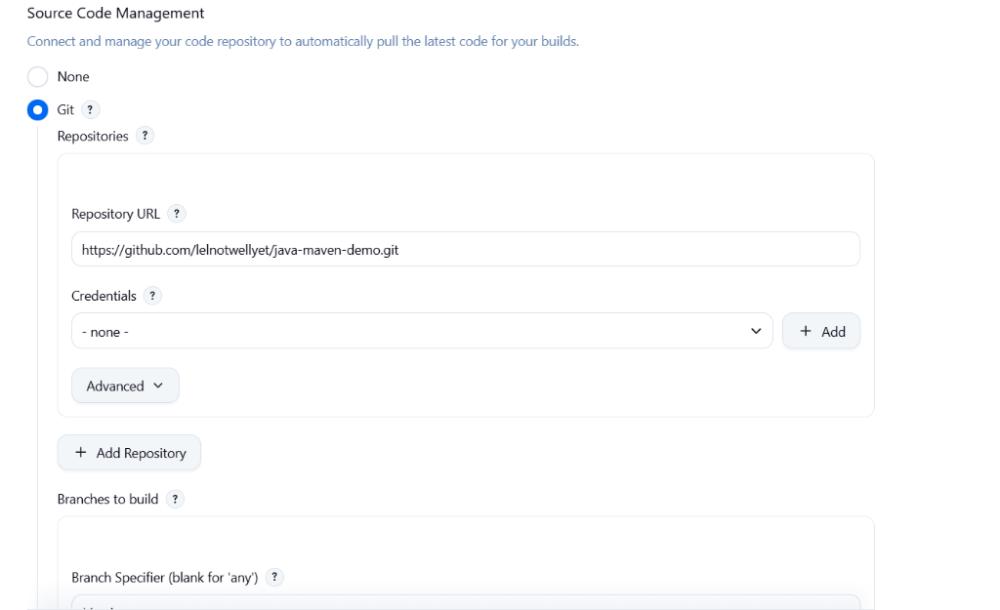
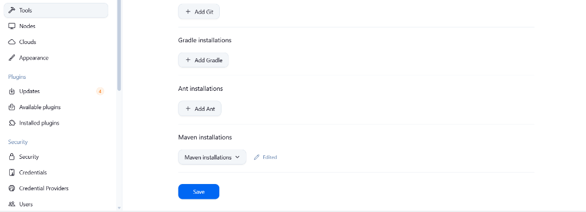
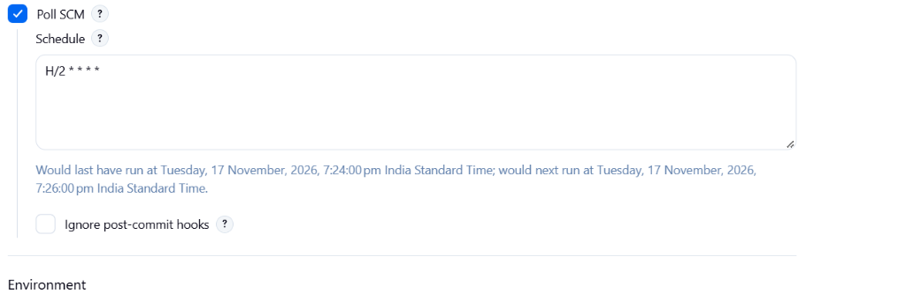
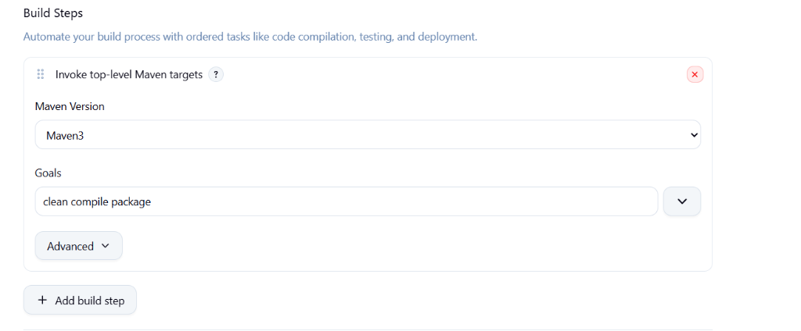

# Practical 2: Jenkins Freestyle Job with Maven (CI/CD Pipeline)

> **Exam / Lab Weightage:** 30 Marks  
> **Associated GitHub Repository:** [lelnotwellyet/java-maven-demo](https://github.com/lelnotwellyet/java-maven-demo)  
> **Jenkins Job Name:** `java-build-job`

---

## Table of Contents
1. [Q2.1: Install & Start Jenkins, Admin Setup, Plugins (6 Marks)](#q21-install--start-jenkins-admin-setup-plugins-6-marks)
2. [Q2.2: Create Freestyle Job `java-build-job` (4 Marks)](#q22-create-freestyle-job-java-build-job-4-marks)
3. [Q2.3: Connect Job to Java Maven Project (6 Marks)](#q23-connect-job-to-java-maven-project-6-marks)
4. [Q2.4: Poll SCM (Every 2 Minutes) & Configure Maven (7 Marks)](#q24-poll-scm-every-2-minutes--configure-maven-7-marks)
5. [Q2.5: Run the Build & Verify Console Output (7 Marks)](#q25-run-the-build--verify-console-output-7-marks)
6. [Troubleshooting Guide](#troubleshooting-guide)
7. [Screenshots Checklist](#screenshots-checklist)

---

## Q2.1: Install & Start Jenkins, Admin Setup, Plugins (6 Marks)

### Lab PC Check (Before Installing)
Open your browser to `http://localhost:8080` and check which screen appears:
1. **Unlock Jenkins page:** Setup was never completed. Copy the administrator password from:
   ```cmd
   C:\ProgramData\Jenkins\.jenkins\secrets\initialAdminPassword
   ```
   and proceed to step 7 below.
2. **Login page / Dashboard:** Jenkins was already installed and set up. Clean install:
   - Run `net stop jenkins` in Administrator PowerShell.
   - Uninstall Jenkins from **Settings > Apps > Installed apps**.
   - Delete folders `C:\ProgramData\Jenkins` and `C:\Program Files\Jenkins`.
   - If unable to uninstall, re-run installer choosing port `8081` and a new empty Jenkins home folder, then use `http://localhost:8081`.
3. **Page does not load:** Run `net start jenkins` in Administrator PowerShell. If the service does not exist, follow the fresh install steps below.

---

### Step-by-Step Installation
1. **Install Java 21** (PowerShell as Administrator):
   ```powershell
   winget install EclipseAdoptium.Temurin.21.JDK
   ```
2. Close PowerShell, open a new window, and verify:
   ```powershell
   java -version
   ```
   *Must show version 21. If it shows Java 17, see the JDK Fix below.*
3. **Verify Git:**
   ```powershell
   git --version
   ```
   *If missing, install Git for Windows with default settings.*
4. Download Jenkins LTS Windows installer (`.msi`) from [jenkins.io/download](https://www.jenkins.io/download/).
5. Run the installer:
   - **Logon type:** Run service as `LocalSystem`.
   - **Port:** `8080` (click *Test Port*, then *Next*).
   - **Java home:** Select your JDK 21 directory (e.g. `C:\Program Files\Eclipse Adoptium\jdk-21...`).
   - Click **Install**, then **Finish**.
6. Open `http://localhost:8080`. Open Notepad to read the initial secret password:
   ```cmd
   type C:\ProgramData\Jenkins\.jenkins\secrets\initialAdminPassword
   ```
   Paste the password into the browser and click **Continue**.
7. Click **Install suggested plugins** and wait for all plugins to complete with a green checkmark.
8. **Create Admin User:** Fill in username, password, full name, and email. Click **Save and Continue**.
9. Keep Jenkins URL as `http://localhost:8080/`, click **Save and Finish**, then **Start using Jenkins**.
10. **Restart Jenkins Service** so Jenkins detects Git properly:
    ```powershell
    net stop jenkins
    net start jenkins
    ```

> **Screenshots Required for Q2.1:**
> - `java -version` showing Java 21
> - Unlock Jenkins page
> - Plugins installation page (green ticks)
> - Create Admin User form
> - Jenkins Dashboard

---

### Fix: If `java -version` Shows 17 After Installing 21
1. Check installed JDKs and which `java.exe` is resolved first:
   ```cmd
   dir "C:\Program Files\Eclipse Adoptium"
   where java
   ```
2. **Temporary Fix (Current terminal session only):**
   ```cmd
   set "JAVA_HOME=C:\Program Files\Eclipse Adoptium\jdk-21.0.13.9-hotspot"
   set "PATH=%JAVA_HOME%\bin;%PATH%"
   java -version
   ```
3. **Permanent Fix:**
   - Press `Win`, search for **Edit the system environment variables**, and open it.
   - Click **Environment Variables**.
   - Under **System Variables**, set or create `JAVA_HOME` pointing to your JDK 21 directory.
   - Under `Path`, edit and move the `jdk-21...\bin` entry above `jdk-17`, or remove the JDK 17 path.
   - Open a fresh Command Prompt and verify `java -version`.

---

## Q2.2: Create Freestyle Job `java-build-job` (4 Marks)

1. On the Jenkins dashboard, click **New Item** (top left).
2. Enter the item name: `java-build-job`.
3. Select **Freestyle project**.
4. Click **OK**.

> **Screenshot Required for Q2.2:** The New Item page with `java-build-job` entered and `Freestyle project` selected.

---

## Q2.3: Connect Job to Java Maven Project (6 Marks)

### Step A: Create GitHub Project `java-maven-demo`
1. On GitHub, create a new public repository named `java-maven-demo` with a README.
2. At the repository root, create `pom.xml`:
   ```xml
   <project xmlns="http://maven.apache.org/POM/4.0.0">
     <modelVersion>4.0.0</modelVersion>
     <groupId>com.example</groupId>
     <artifactId>java-maven-demo</artifactId>
     <version>1.0</version>
     <packaging>jar</packaging>
     <properties>
       <maven.compiler.release>17</maven.compiler.release>
       <project.build.sourceEncoding>UTF-8</project.build.sourceEncoding>
     </properties>
     <dependencies>
       <dependency>
         <groupId>junit</groupId>
         <artifactId>junit</artifactId>
         <version>4.13.2</version>
         <scope>test</scope>
       </dependency>
     </dependencies>
   </project>
   ```
3. Create `src/main/java/com/example/App.java`:
   ```java
   package com.example;

   public class App {
       public static int add(int a, int b) {
           return a + b;
       }
       public static void main(String[] args) {
           System.out.println("Hello from Jenkins Maven build! 2 + 3 = " + add(2, 3));
       }
   }
   ```
4. Create unit test `src/test/java/com/example/AppTest.java`:
   ```java
   package com.example;

   import static org.junit.Assert.assertEquals;
   import org.junit.Test;

   public class AppTest {
       @Test
       public void testAdd() {
           assertEquals(5, App.add(2, 3));
       }
   }
   ```

---

### Step B: Connect Jenkins Job to Git
1. Open `java-build-job` and click **Configure**.
2. Under **Source Code Management**, select **Git**.
3. **Repository URL:** `https://github.com/lelnotwellyet/java-maven-demo.git`
4. **Credentials:** `- none -` *(public repository)*.
5. **Branch Specifier:** `*/main`



> **Screenshot Required for Q2.3:** The GitHub repo showing `pom.xml` and `src`, and the Source Code Management configuration filled in.

---

## Q2.4: Poll SCM (Every 2 Minutes) & Configure Maven (7 Marks)

### Step A: Configure Maven in Jenkins Global Tools
1. Navigate to **Manage Jenkins > Tools**.
2. Scroll to **Maven installations** and click **Add Maven**.
3. **Name:** `Maven3`
4. Check **Install automatically** (select latest version `3.9.x`).
5. Click **Save**.



*(Note: If "Invoke top-level Maven targets" is missing in job build steps, go to **Manage Jenkins > Plugins > Available plugins**, install **Maven Integration**, and restart Jenkins).*

---

### Step B: Configure Job Triggers & Build Steps
1. In `java-build-job`, click **Configure**.
2. Under **Build Triggers**:
   - Check **Poll SCM**.
   - **Schedule:** `H/2 * * * *` *(polls GitHub for changes every 2 minutes)*.



3. Under **Build Steps**:
   - Click **Add build step > Invoke top-level Maven targets**.
   - **Maven Version:** Select `Maven3`.
   - **Goals:** `clean compile package`



4. Click **Save**.

> **Screenshots Required for Q2.4:**
> - Poll SCM trigger enabled with `H/2 * * * *`.
> - Build Steps showing `Maven3` and goals `clean compile package`.

---

## Q2.5: Run the Build & Verify Console Output (7 Marks)

### 1. Manual Build Execution (#1)
- Click **Build Now** on the left menu.
- Under **Build History**, click `#1 > Console Output`.
- Verify the build output finishes with:
  ```text
  [INFO] Tests run: 1, Failures: 0, Errors: 0, Skipped: 0
  [INFO] Building jar: ...\target\java-maven-demo-1.0.jar
  [INFO] BUILD SUCCESS
  Finished: SUCCESS
  ```

### 2. Automated SCM Poll Build (#2)
- Go to GitHub and edit `App.java` (e.g. modify the printed greeting string).
- Commit the change to `main`.
- Wait up to 2 minutes: Jenkins polls SCM, detects the new commit, and triggers **Build #2** automatically.
- Open **Build #2 > Console Output** and verify:
  ```text
  Started by an SCM change
  ...
  BUILD SUCCESS
  Finished: SUCCESS
  ```

> **Screenshots Required for Q2.5:**
> - Build #1 Console Output showing `BUILD SUCCESS`.
> - Build #2 Console Output showing `Started by an SCM change`.

---

## Troubleshooting Guide

| Issue / Console Output Error | Cause | Resolution |
| :--- | :--- | :--- |
| `no POM in this directory` / `No such file: pom.xml` | `pom.xml` is inside a subdirectory or missing | Ensure `pom.xml` is placed at the exact repository root |
| `release version 17 not supported` | Jenkins is running under Java 8 or 11 | Upgrade Jenkins runtime JDK or configure JDK 17/21 under **Manage Jenkins > Tools** |
| `couldn't find remote ref refs/heads/master` | Repository default branch is `main` | Set **Branch Specifier** to `*/main` |
| `Tests run: 1, Failures: 1` | Unit test mismatch in `AppTest.java` | Ensure `App.add(2, 3)` returns `5` to match `assertEquals(5, ...)` |
| No `Maven Version` dropdown / `mvn not found` | Maven tool not configured in Jenkins | Add `Maven3` under **Manage Jenkins > Tools > Maven installations** |

---

## Screenshots Checklist

- [ ] **1.** `java -version` showing JDK 21
- [ ] **2.** Unlock Jenkins page (`initialAdminPassword`)
- [ ] **3.** Plugins installation in progress / completed
- [ ] **4.** Create First Admin User page
- [ ] **5.** New Item page with `java-build-job` (Freestyle project)
- [ ] **6.** GitHub repo view (`pom.xml`, `src/`)
- [ ] **7.** Source Code Management configured (`https://github.com/lelnotwellyet/java-maven-demo.git`, `*/main`)
- [ ] **8.** Maven tool setup (`Maven3`) under Tools
- [ ] **9.** Build Triggers: Poll SCM `H/2 * * * *`
- [ ] **10.** Build Step: `Maven3` with goals `clean compile package`
- [ ] **11.** Build #1 Console Output (`BUILD SUCCESS`)
- [ ] **12.** Build #2 Console Output (`Started by an SCM change`)
