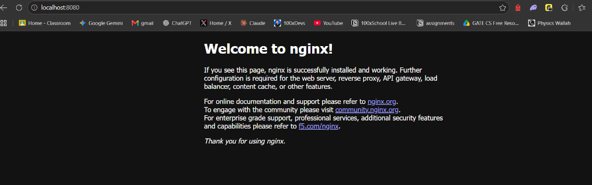

# Practical 4: Docker Basics (Windows)

> **Exam / Lab Weightage:** 30 Marks  
> **Topic:** Containerization with Docker & Nginx on Windows  
> **Container Names:** `nginx-test`, `my-web-container`  
> **Ports Tested:** `8080` (Default Nginx test), `8081` (Custom Web App)

---

## Table of Contents
1. [Prerequisites & Environment Setup](#prerequisites--environment-setup)
2. [Q4.1: Pull Nginx, Run on Port 8080 & Verify (6 Marks)](#q41-pull-nginx-run-on-port-8080--verify-6-marks)
3. [Q4.2: Create the Web App with `index.html` (5 Marks)](#q42-create-the-web-app-with-indexhtml-5-marks)
4. [Q4.3: Write the Dockerfile with `nginx:alpine` (8 Marks)](#q43-write-the-dockerfile-with-nginxalpine-8-marks)
5. [Q4.4: Build `my-web-app:v1` & Run on Port 8081 (6 Marks)](#q44-build-my-web-appv1--run-on-port-8081-6-marks)
6. [Q4.5: Container Management Commands (5 Marks)](#q45-container-management-commands-5-marks)
7. [Troubleshooting Guide](#troubleshooting-guide)
8. [Screenshots Checklist](#screenshots-checklist)

---

## Prerequisites & Environment Setup

1. **Docker Desktop:** Ensure Docker Desktop is launched and the status indicator at the bottom-left shows **Engine running**. No Docker commands will work until the daemon is active.
2. **PowerShell as Administrator:** Open PowerShell as Administrator (Search *PowerShell* in Windows Start, right-click, select *Run as administrator*).
3. **Windows CLI Conventions:**
   - Use `type` instead of Linux `cat`.
   - Use `findstr` instead of Linux `grep`.
   - Use `net stop <service>` / `net start <service>` to manage Windows background services (like Jenkins).

---

## Q4.1: Pull Nginx, Run on Port 8080 & Verify (6 Marks)

Jenkins by default uses port `8080`. To avoid port conflicts during this test, stop the Jenkins service first:

```powershell
net stop jenkins
```
*(Skip if Jenkins is not installed or not running on port 8080).*

### 1. Pull the Official Nginx Image
```powershell
docker pull nginx
```

### 2. Run the Nginx Container
```powershell
docker run -d --name nginx-test -p 8080:80 nginx
```
- `-d`: Run container in detached mode (background).
- `--name nginx-test`: Name assigned to the running container instance.
- `-p 8080:80`: Map host port `8080` to container port `80`.

### 3. Verify in Browser
Open `http://localhost:8080` in your web browser. You should see the official default **Welcome to nginx!** page:



### 4. Stop Container & Free Port 8080
Once verified and screenshotted, stop the container and resume Jenkins if needed:
```powershell
docker stop nginx-test
net start jenkins
```

> **Screenshots Required for Q4.1:**
> - `docker run` command output in terminal.
> - Browser showing **Welcome to nginx!** at `http://localhost:8080`.

---

## Q4.2: Create the Web App with `index.html` (5 Marks)

Create a dedicated folder for your custom web application:

```powershell
mkdir mywebapp
cd mywebapp
```

Create `index.html` with your custom details:

```powershell
@'
<h1>Hello Docker</h1>
<p>Your Name - Your Roll Number</p>
'@ | Set-Content -Encoding ascii index.html
```
*(Note: In PowerShell, the closing `@' must be at the very start of its own line).*

Verify the file contents:
```powershell
type index.html
```

> **Screenshot Required for Q4.2:** Output of `type index.html` showing the custom HTML page.

---

## Q4.3: Write the Dockerfile with `nginx:alpine` (8 Marks)

In the same `mywebapp` directory, create a `Dockerfile` (no extension):

```powershell
@'
FROM nginx:alpine
COPY index.html /usr/share/nginx/html/index.html
EXPOSE 80
'@ | Set-Content -Encoding ascii Dockerfile
```

Verify the `Dockerfile`:
```powershell
type Dockerfile
```

### Dockerfile Instruction Breakdown

| Instruction | Explanation |
| :--- | :--- |
| `FROM nginx:alpine` | Uses the lightweight Alpine Linux-based Nginx official image as the base image (saves disk space & build time). |
| `COPY index.html /usr/share/nginx/html/index.html` | Copies your local `index.html` into the default document root directory where Nginx serves static HTML files. |
| `EXPOSE 80` | Documents that the container will listen on port `80` at runtime. |

> **Screenshot Required for Q4.3:** Output of `type Dockerfile` displaying the three directives.

---

## Q4.4: Build `my-web-app:v1` & Run on Port 8081 (6 Marks)

Make sure your terminal is inside the `mywebapp` folder where `Dockerfile` and `index.html` are located.

### 1. Build the Docker Image
```powershell
docker build -t my-web-app:v1 .
```
*(Notice the trailing `.` dot: specifies the current directory as the build context).*

### 2. Run the Custom Web App Container on Port 8081
```powershell
docker run -d --name my-web-container -p 8081:80 my-web-app:v1
```

### 3. Verify in Browser
Open `http://localhost:8081` in your browser.  
It will display your custom web page:
```text
Hello Docker
Your Name - Your Roll Number
```

*(If port 8081 is already in use by an old container, remove it with `docker rm -f <container-name>` and re-run).*

> **Screenshots Required for Q4.4:**
> - Terminal output of `docker build -t my-web-app:v1 .`
> - Browser showing **Hello Docker** at `http://localhost:8081`.

---

## Q4.5: Container Management Commands (5 Marks)

First, refresh `http://localhost:8081` once in your browser to generate access log entries.  
Then run and screenshot each of the following commands:

### 1. View Running Containers
```powershell
docker ps
```
*Displays currently running containers (`my-web-container`), container IDs, image names, and port mappings (`0.0.0.0:8081->80/tcp`).*

### 2. List Local Docker Images
```powershell
docker images
```
*Lists all pulled and built images on your system (`nginx`, `nginx:alpine`, and `my-web-app:v1`).*

### 3. Inspect Container Access Logs
```powershell
docker logs my-web-container
```
*Displays Nginx HTTP access log lines corresponding to the browser requests made to port 8081.*

### 4. Stop the Container
```powershell
docker stop my-web-container
```
*Gracefully terminates the container process.*

### 5. Remove the Container
```powershell
docker rm my-web-container
```
*Deletes the stopped container instance.*

### 6. Verify Container Removal
```powershell
docker ps -a
```
*Confirms that `my-web-container` has been removed from the system.*

*(Optional cleanup for the initial test container)*:
```powershell
docker rm nginx-test
```

### Command Reference Summary

| Command | Action / What it Shows |
| :--- | :--- |
| `docker ps` | Lists active/running containers with mapped ports |
| `docker images` | Lists all local container images |
| `docker logs <name>` | Fetches stdout/stderr logs (e.g. Nginx HTTP requests) |
| `docker stop <name>` | Sends SIGTERM to stop a running container |
| `docker rm <name>` | Deletes an exited container |
| `docker ps -a` | Lists all containers (running + stopped) to verify cleanup |

---

## Troubleshooting Guide

| Error Message | Common Cause | Fix / Solution |
| :--- | :--- | :--- |
| `error during connect / cannot connect to Docker daemon` | Docker Desktop is not started | Open Docker Desktop application and wait until **Engine running** shows in green |
| `port is already allocated` / `address already in use` | Another process or container is using port 8080/8081 | Stop Jenkins (`net stop jenkins`) or remove existing container (`docker rm -f <container>`). Check with `netstat -ano \| findstr :8080` |
| `container name is already in use` | Container was stopped or created earlier without removal | Remove conflicting container: `docker rm -f <container-name>` |
| `'docker' is not recognized` | PATH variable missing Docker bin | Reopen PowerShell after Docker Desktop install, or restart PC |
| `COPY failed: file not found` | `index.html` not present in build context | Verify you are inside `mywebapp` folder (`dir`) where `index.html` exists |

---

## Screenshots Checklist

- [ ] **1.** `docker run` command & Nginx Welcome page at `http://localhost:8080`
- [ ] **2.** `type index.html` showing custom HTML content
- [ ] **3.** `type Dockerfile` showing the 3 directives
- [ ] **4.** `docker build -t my-web-app:v1 .` terminal output
- [ ] **5.** Custom Web App running at `http://localhost:8081`
- [ ] **6.** `docker ps` showing running container
- [ ] **7.** `docker images` showing images list
- [ ] **8.** `docker logs my-web-container` showing access logs
- [ ] **9.** `docker stop my-web-container` and `docker rm my-web-container`
- [ ] **10.** `docker ps -a` showing container cleanup
